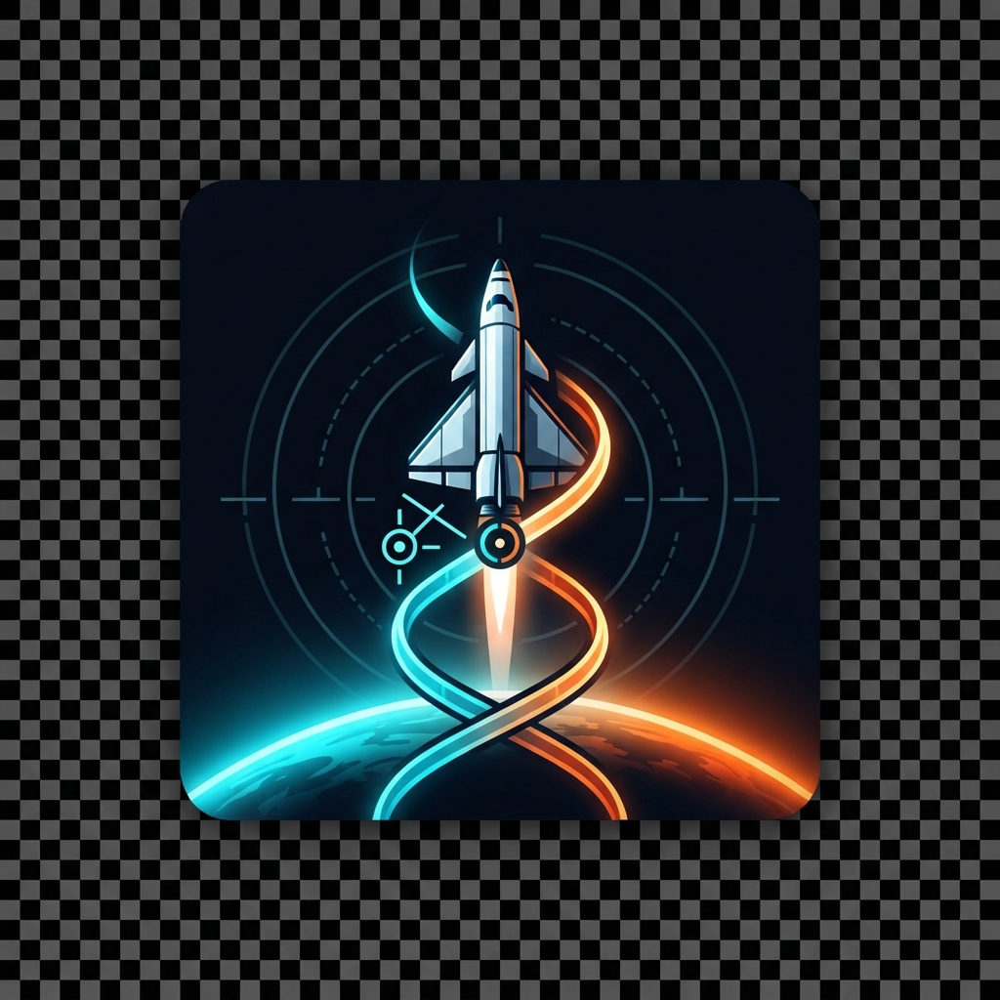

# Helix Spaceflight Simulator



A from-scratch C++20 / DirectX 12 spaceflight sim — no engine, no middleware
beyond the Windows SDK (DX12, XAudio2, XInput, Raw Input). One continuous
world from high orbit to the surface, flown with mouse, HOTAS, gamepad, or
plain keyboard.

In the tradition of *Kerbal Space Program* meets *Flight Simulator*, with
*x*-series cockpit instrumentation. Solo-first; the architecture leaves room
for multiplayer later.

See [SPEC.md](SPEC.md) for the full game specification, feature set, and
milestone plan (M1–M4 + renderer roadmap R1–R6).

## Current status — M1 "playable loop"

- **Boot flow** — staged loading screen, pilot registration (callsign entry
  with persistence), main menu, mission select, debrief, pause
- **Custom UI framework** — retained-mode panels/buttons/hit regions rendered
  as textured D3D12 quads
- **Bitmap font pipeline** — GDI-rasterized R8 glyph atlas, dynamic text
  layout, caret, HUD numeric readouts
- **Career missions** — 5 missions with real completion logic (test-flight,
  multi-landing, orbital transit); pilot profile saved to
  `%LOCALAPPDATA%\HelixSim\profile.cfg`
- **Flight model** — 6-DOF Newtonian rigid body, inverse-square gravity,
  exponential atmosphere, drag + lift with stall, flight-assist damping,
  fixed 120 Hz physics step
- **Ship systems** — engine modes, power priority, landing gear, weapons
  arm/fire/cooldown, shields/hull/subsystem health, fuel, engine heat,
  landing-quality scoring, crash detection
- **Renderer** — D3D12 lit opaque pipeline (ship, terrain heightfield,
  planet sphere) + alpha line pipeline + textured UI pipeline
- **Audio** — XAudio2 procedural engine hum, wind, re-entry roar, one-shot SFX
- **Input** — Raw Input (mouse/HOTAS) + XInput gamepad + keyboard fallback,
  unified bindable action map

## Build (Windows 10/11, Visual Studio 2026)

```
mkdir build
cd build
cmake .. -G "Visual Studio 18 2026" -A x64
cmake --build . --config Debug
```

A root `HelixSim.slnx` is also provided — it opens the Debug build tree
directly in VS 2026.

Run `HelixSim.exe` from `build/Debug` (or `Release`). The `shaders/` folder
is copied next to the executable automatically — the renderer compiles HLSL
at runtime via `D3DCompileFromFile`, so it must sit alongside the .exe.

Requires the Windows 10/11 SDK and a DX12-capable GPU/driver. Init failures
show a message box naming the exact failing step and HRESULT; a rotating log
is written to `HelixSim.log` next to the exe.

## Roadmap (see SPEC.md for detail)

- **M1.6** — projectiles, damage resolution, patrol AI
- **M1.7** — terrain-height landing checks, save/load
- **M1.8** — renderer R1+R2 (PBR/IBL, HDR/tonemap/bloom/TAA)
- **M2+** — MFD cockpit screens, orbital→atmosphere LOD, re-entry effects,
  docking, three-act campaign, intro sequence

## License

MIT — see [LICENSE](LICENSE).
